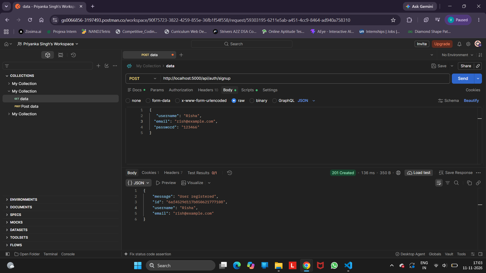
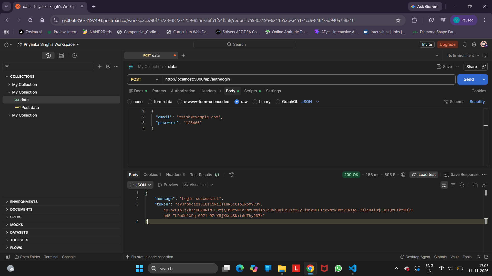
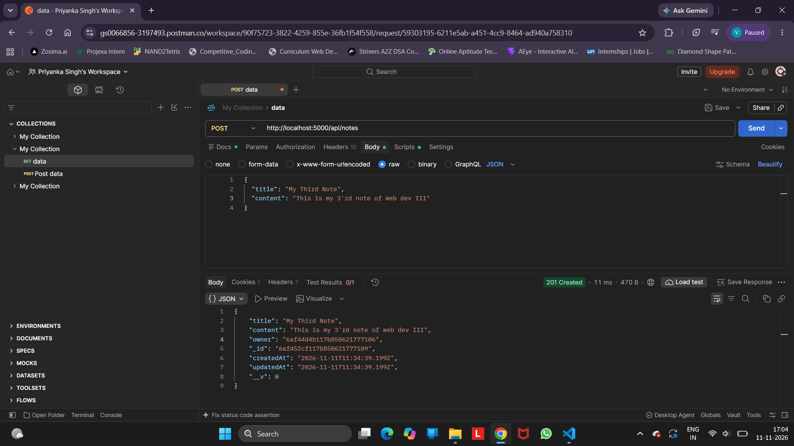
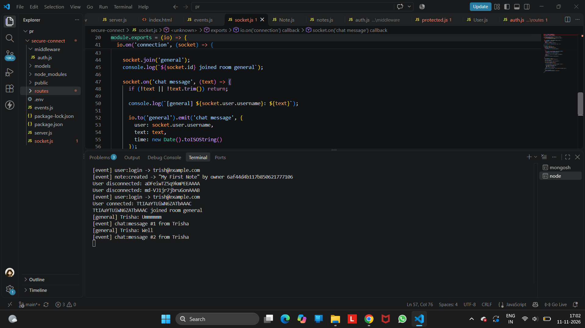

# Secure Connect and Communication Platform

A backend app made with Node.js and Express where users can sign up, log in, manage their own notes and chat in real time. Everything is written from scratch without any auth boilerplate.

## Features

- Signup and login with bcrypt password hashing
- JWT authentication and protected routes
- Role based access (user and admin)
- Notes CRUD, each user sees only their own notes
- Real time chat with Socket.IO (room: `general`), secured with JWT
- Event logging using EventEmitter
- Secrets stored in `.env` using dotenv

## Tech stack

Node.js, Express, MongoDB , bcrypt, jsonwebtoken, Socket.IO, dotenv

## How to run

1. Make sure MongoDB is running
2. Install packages: `npm install`
3. Create a `.env` file:
   ```
   PORT=5000
   MONGO_URI=mongodb://127.0.0.1:27017/secureconnect
   JWT_SECRET=your_secret_here
   ```
4. Start the server: `node server.js`

## API endpoints

| Method | Endpoint | Access |
|---|---|---|
| POST | `/api/auth/signup` | Public |
| POST | `/api/auth/login` | Public |
| GET | `/api/me` | Logged in |
| GET | `/api/admin/users` | Admin only |
| POST / GET | `/api/notes` | Logged in |
| GET / PUT / DELETE | `/api/notes/:id` | Logged in |

Token is sent as `Authorization: Bearer <token>`. Login also sets a `token` cookie.

## Chat

Open `http://localhost:5000` in two tabs, paste a different user's token in each, click Connect and send messages.

## Screenshots

### Signup and Login


### Notes API without token


### Notes API with token


### Real time chat


## What I learned

- Why passwords are hashed and how JWT works
- Difference between authentication and authorization
- How middleware protects routes
- How WebSockets are different from normal HTTP